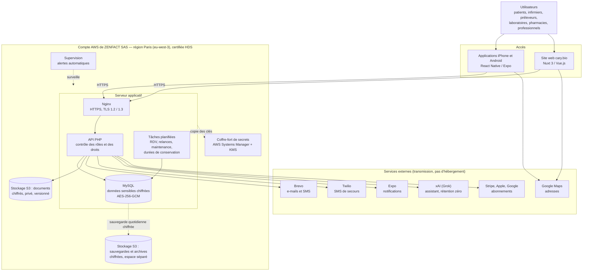
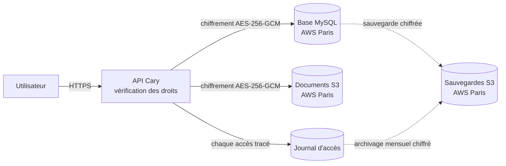
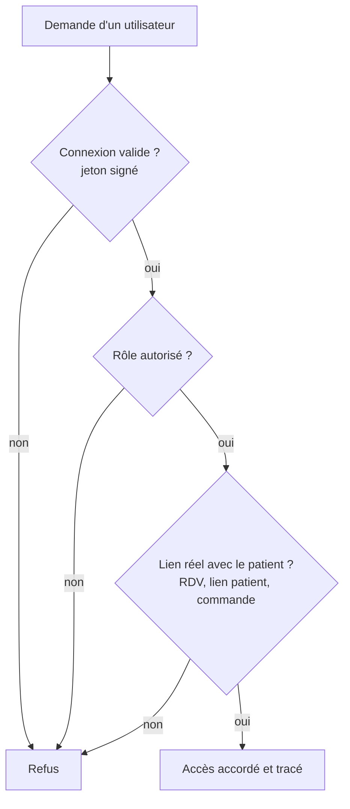

# Cary : schéma de l'architecture

| | |
|---|---|
| **Propriétaire de la plateforme Cary** | **ZENFACT SAS** |
| **Prestataire de développement** | **Startbiz LLC** — License 2218328.01 |

Ce document présente l'architecture générale de la plateforme Cary. Il décrit les grandes briques et la circulation des données, pas le détail de la configuration ni des procédures d'exploitation.

---

## 1. Vue d'ensemble

---

## 2. Les briques

| Brique | Rôle | Où |
|---|---|---|
| **Applications mobiles** | Appli iPhone et Android, un seul code (React Native / Expo). | Téléphones des utilisateurs |
| **Site web** | Site cary.bio et espaces connectés (Nuxt 3). | AWS Paris |
| **API** | Toute la logique métier : comptes, RDV, dossiers, documents, commandes, abonnements. Vérifie le rôle et les droits à chaque demande. | AWS Paris |
| **Base de données** | MySQL. Les données sensibles sont chiffrées champ par champ. | AWS Paris |
| **Documents** | Ordonnances, cartes Vitale, photos de soins, pièces jointes. Chiffrés par l'application puis par S3. | AWS S3 Paris |
| **Sauvegardes et archives** | Sauvegarde quotidienne de la base, archives du journal d'accès. Espace séparé, protégé contre la suppression depuis le serveur. | AWS S3 Paris |
| **Coffre-fort de secrets** | Copie chiffrée des clés et de la configuration. | AWS Paris |
| **Supervision** | Surveillance continue du service, alertes automatiques en cas d'anomalie. | AWS Paris |

---

## 3. Circulation des données de santé

- Les données de santé sont **stockées uniquement chez AWS, région Paris**, sur le compte de ZENFACT SAS.
- Elles sont **chiffrées** en transit (HTTPS) et au repos (AES-256-GCM, puis chiffrement du stockage AWS).
- **Chaque accès** à une donnée de santé est enregistré dans le journal d'accès.
- Les services externes **ne stockent pas** le dossier patient : ils transmettent des messages courts (e-mail, SMS, notification) ou reçoivent des données masquées (assistant IA).

---

## 4. Séparation des accès

Rôles : patient, infirmier, préleveur, laboratoire, sous-compte de laboratoire, professionnel (médecin, pharmacie…), administrateur. Tous les contrôles sont faits **côté serveur**.

---

## 5. Continuité et montée en charge

- **Sauvegardes** quotidiennes, chiffrées, vérifiées et copiées sur S3 ; restauration testée automatiquement chaque mois.
- **Documents** sur S3, sans limite de taille, avec historique des versions.
- **Serveur dimensionné au juste besoin** pour maîtriser les coûts. Sur AWS, il peut passer à une taille supérieure en quelques minutes, sans changer le code.
- **Tous les comptes** (AWS, domaine, magasins d'applications, services externes, code source) sont au nom de ZENFACT SAS.
