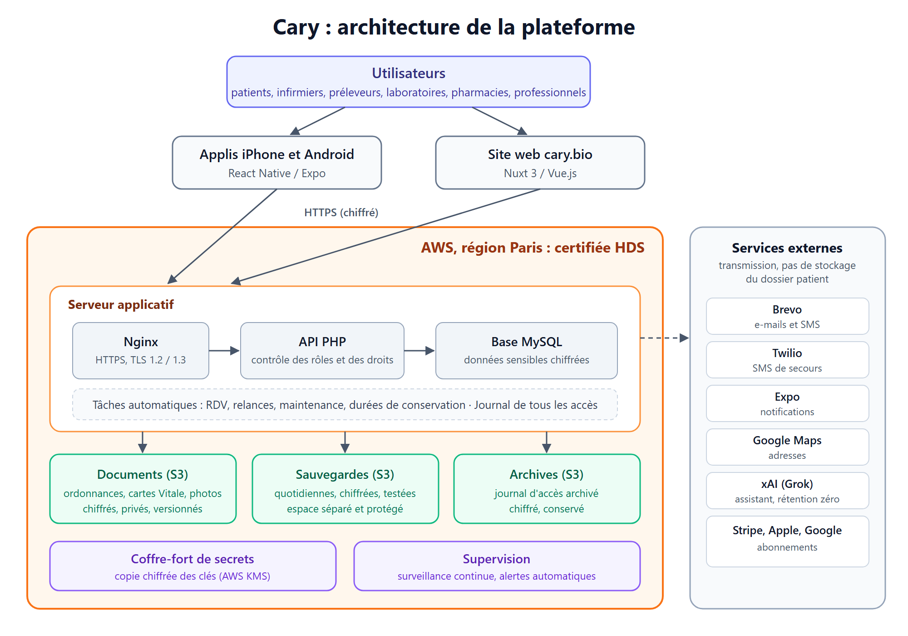

# Cary : schéma de l'architecture

Ce document présente l'architecture générale de la plateforme Cary : les grandes briques et la circulation des données.

---

## 1. Vue d'ensemble

---

## 2. Les briques

| Brique | Rôle | Où |
|---|---|---|
| **Applications mobiles** | Appli iPhone et Android, un seul code (React Native / Expo). | Téléphones des utilisateurs |
| **Site web** | Site cary.bio et espaces connectés (Nuxt 3). | AWS Paris |
| **API** | Toute la logique métier : comptes, RDV, dossiers, documents, commandes, abonnements. Vérifie le rôle et les droits à chaque demande. | AWS Paris |
| **Base de données** | MySQL. Les données sensibles sont chiffrées champ par champ. | AWS Paris |
| **Documents** | Ordonnances, cartes Vitale, photos de soins, pièces jointes. Chiffrés par l'application puis par S3. | AWS S3 Paris |
| **Sauvegardes et archives** | Sauvegarde quotidienne de la base, archives du journal d'accès. Espace séparé, protégé contre la suppression depuis le serveur. | AWS S3 Paris |
| **Coffre-fort de secrets** | Copie chiffrée des clés et de la configuration. | AWS Paris |
| **Supervision** | Surveillance continue du service, alertes automatiques en cas d'anomalie. | AWS Paris |
| **Services externes** | E-mails et SMS (Brevo, Twilio), notifications (Expo), adresses (Google Maps), assistant (xAI), abonnements (Stripe, Apple, Google). | Hors AWS |

---

## 3. Circulation des données de santé

1. L'utilisateur se connecte depuis l'appli ou le site, en **HTTPS** (connexion chiffrée).
2. L'**API** vérifie qui il est, son rôle et son lien avec le patient.
3. Les données sont **chiffrées** (AES-256-GCM) puis enregistrées dans la **base** ou dans le **stockage des documents**, chez AWS Paris.
4. **Chaque accès** à une donnée de santé est inscrit dans le **journal d'accès**.
5. Chaque nuit, la base est **sauvegardée**, chiffrée, dans un espace séparé. Le journal d'accès est **archivé** chaque mois.

Les données de santé sont **stockées uniquement chez AWS, région Paris**. Les services externes ne stockent pas le dossier patient : ils transmettent des messages courts (e-mail, SMS, notification) ou reçoivent des données masquées (assistant IA).

---

## 4. Séparation des accès

À chaque demande, le serveur vérifie trois choses, dans cet ordre :

| Contrôle | Si non |
|---|---|
| 1. La connexion est-elle valide ? | Refus |
| 2. Le rôle permet-il cette action ? | Refus |
| 3. L'utilisateur a-t-il un lien réel avec ce patient (RDV, lien patient, commande) ? | Refus |

Si les trois sont validés, l'accès est accordé **et tracé**.

Rôles : patient, infirmier, préleveur, laboratoire, sous-compte de laboratoire, professionnel (médecin, pharmacie…), administrateur.

---

## 5. Continuité et montée en charge

- **Sauvegardes** quotidiennes, chiffrées, vérifiées et copiées sur S3 ; restauration testée automatiquement chaque mois.
- **Documents** sur S3, sans limite de taille, avec historique des versions.
- **Serveur dimensionné au juste besoin** pour maîtriser les coûts. Sur AWS, il peut passer à une taille supérieure en quelques minutes, sans changer le code.
